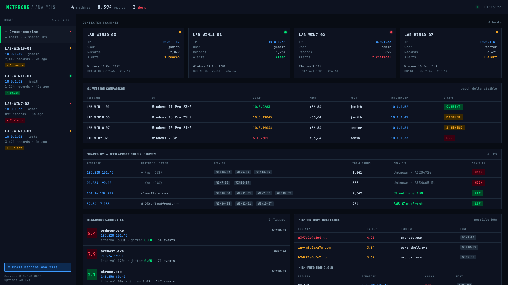
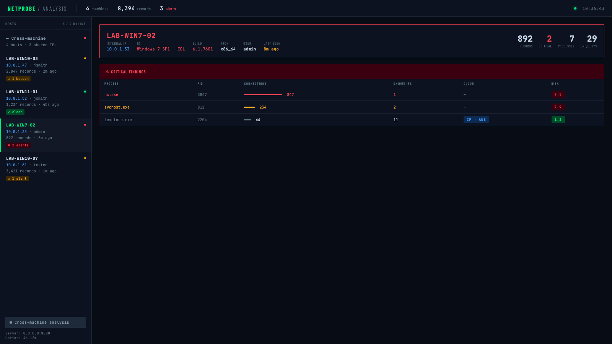
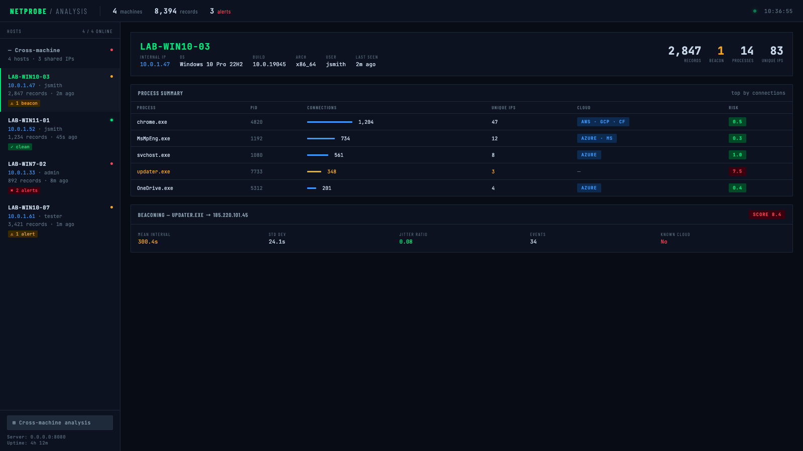
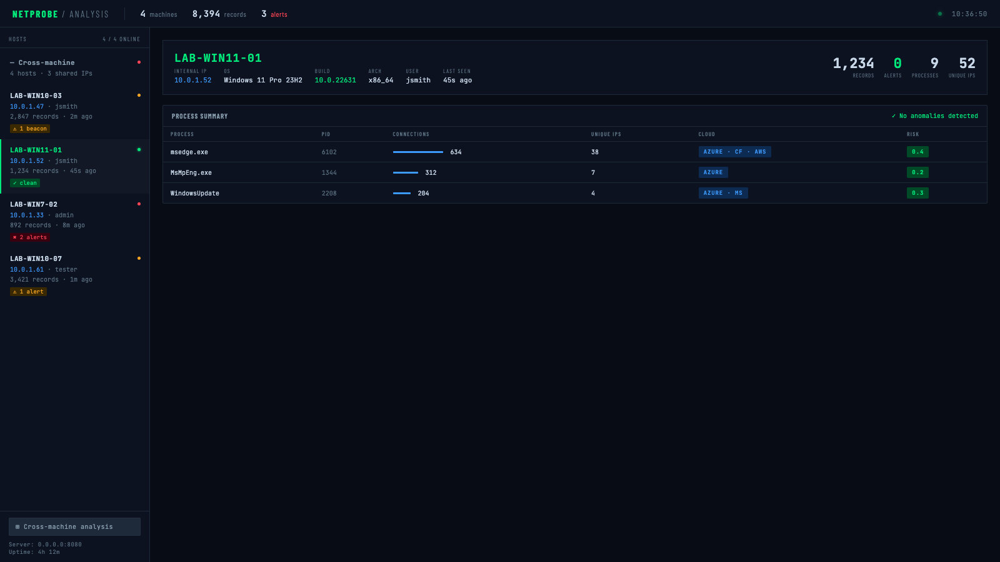

# Gibson

Network monitoring tool that maps process-to-network connections, identifies cloud providers, and generates firewall rules. Lightweight agent for collection, server for aggregation, parser for analysis.

## Screenshots

**Cross-machine overview** — OS version comparison, shared IP detection, beaconing candidates across all hosts:


**Per-host detail — critical alerts** (EOL OS, `nc.exe` beaconing to unknown IP):


**Per-host detail — warning** (beacon candidate flagged):


**Per-host detail — clean** (no anomalies):


## Features

### Collector (Agent)
- 🔒 **Secure**: Optional AES-256-GCM encryption
- 🗜️ **Efficient**: Optional gzip compression
- 🌐 **Cloud Upload**: HTTP/HTTPS upload with API key support
- 📊 **Real-time**: Streaming data collection
- 🔍 **DNS Resolution**: Optional reverse DNS lookups
- 💾 **Flexible Storage**: JSONL format for easy parsing

### Parser (Analyzer)
- ☁️ **Cloud Detection**: Identifies AWS, Azure, GCP, Cloudflare, etc.
- 🔥 **Firewall Rules**: Auto-generates iptables/Windows rules
- 📈 **Risk Scoring**: Identifies suspicious processes
- 🗄️ **Database Export**: SQL export for further analysis
- 📊 **Rich Reports**: JSON summaries with detailed insights

## Quick Start

### Build
```bash
cargo build --release
```

### Basic Collection (5 minutes)
```bash
# Simple collection
cargo run --release -- collect --duration-seconds 300

# With DNS lookups
cargo run --release -- collect --duration-seconds 300 --enable-dns

# With compression and encryption
cargo run --release -- collect \
  --duration-seconds 300 \
  --compress \
  --encrypt-key "your-secret-password"
```

### Parse Collected Data
```bash
# Generate all reports
cargo run --release -- parse \
  --input connections.jsonl \
  --process-summary processes.json \
  --cloud-analysis cloud.json \
  --firewall-rules-iptables firewall.sh \
  --database-export network.sql

# Offline ownership lookup with local ASN DB (no network calls)
cargo run --release -- parse \
  --input connections.jsonl \
  --cloud-analysis cloud.json \
  --asn-db ip2asn-v4.tsv

# Live ARIN lookup with persistent cache (re-run skips already-queried IPs)
cargo run --release -- parse \
  --input connections.jsonl \
  --cloud-analysis cloud.json \
  --arin-lookup \
  --arin-cache arin_cache.json
```

### All-in-One Monitor Mode
```bash
# Quick 5-minute analysis
cargo run --release -- monitor \
  --duration-seconds 300 \
  --output-dir ./analysis \
  --full-analysis
```

## Agent Build

The `agent` binary is a minimal, zero-flag deployment target. All configuration is burned into the binary at compile time via environment variables — drop it on a target and run it with no arguments.

### Build

```bash
AGENT_SERVER="http://10.0.1.5:8080/upload" \
AGENT_KEY="labkey123" \
AGENT_INTERVAL="5" \
AGENT_BATCH="200" \
AGENT_DURATION="0" \
AGENT_DNS="false" \
AGENT_ENCRYPT_KEY="mysecretpassword" \
cargo build --release --bin agent
```

The resulting binary at `target/release/agent` has no external dependencies and requires no flags:

```bash
./agent
```

### Environment Variables

| Variable | Default | Description |
|---|---|---|
| `AGENT_SERVER` | `http://localhost:8080/upload` | Upload endpoint URL |
| `AGENT_KEY` | *(none)* | `X-API-Key` header value |
| `AGENT_INTERVAL` | `5` | Socket poll interval in seconds |
| `AGENT_BATCH` | `200` | Records per upload batch |
| `AGENT_DURATION` | `0` | Run duration in seconds (`0` = run forever) |
| `AGENT_DNS` | `false` | Resolve IPs to hostnames |
| `AGENT_ESTABLISHED` | `true` | ESTABLISHED connections only |
| `AGENT_LOCAL_COPY` | `false` | Keep a local `.jsonl` copy alongside uploads |
| `AGENT_COMPRESS` | `false` | Gzip compress before upload |
| `AGENT_ENCRYPT_KEY` | *(none)* | AES-256-GCM encrypt payload (password or 64-char hex key) |
| `AGENT_UA` | *(reqwest default)* | HTTP `User-Agent` header |

### Example: Encrypted, Long-term Agent

```bash
AGENT_SERVER="https://collector.internal/upload" \
AGENT_KEY="prod-api-key" \
AGENT_DURATION="0" \
AGENT_INTERVAL="30" \
AGENT_COMPRESS="true" \
AGENT_ENCRYPT_KEY="$(cat /etc/gibson/key)" \
cargo build --release --bin agent
```

## Advanced Usage

### Secure Remote Collection

#### 1. Encrypted Collection with Upload
```bash
cargo run --release -- collect \
  --duration-seconds 3600 \
  --interval-seconds 10 \
  --compress \
  --encrypt-key "your-32-char-hex-key-or-password" \
  --upload-url "https://your-server.com/api/upload" \
  --api-key "your-api-key" \
  --batch-size 50 \
  --delete-after-upload
```

#### 2. Long-term Monitoring (24 hours)
```bash
cargo run --release -- collect \
  --duration-seconds 86400 \
  --interval-seconds 30 \
  --output connections_daily.jsonl \
  --enable-dns \
  --compress
```

### IP Ownership Lookup

The parser supports two mutually exclusive paths for identifying who owns unmatched IPs:

| Method | Flag | Speed | Network | Best for |
|---|---|---|---|---|
| Local ASN DB | `--asn-db` | Instant | None | Repeated analysis, air-gapped environments |
| Live ARIN RDAP | `--arin-lookup` | Slow (per-IP) | Yes | One-off lookups, no local DB available |

**Download the ip2asn database (refresh weekly):**
```bash
curl -O https://iptoasn.com/data/ip2asn-v4.tsv.gz && gunzip ip2asn-v4.tsv.gz
```

When `--asn-db` is provided, `--arin-lookup` is ignored. Use `--arin-cache` to persist ARIN results to disk so re-runs skip already-queried IPs.

### Cloud Provider Analysis

```bash
# Parse with cloud detection focus
cargo run --release -- parse \
  --input connections.jsonl \
  --cloud-analysis cloud_report.json \
  --min-connections 5 \
  --whitelist-processes "chrome,firefox,safari,edge"
```

## Web Server Setup for Data Collection

### Upload validation and quarantine

Being valid JSON is necessary but not sufficient: every record in a
`POST /upload` batch passes a semantic gate **before** it is appended to a
session. A record is rejected when any of the following hold:

- `remote_ip` / `local_addr` is not a bare, parseable IP address (hostnames
  smuggled into the IP field are rejected)
- the local and remote addresses disagree on IPv4 vs IPv6 family
- `remote_port` is missing or `0`; `local_port == 0` when present
- `pid == 0`, `process_name` is empty, or `protocol` is not `TCP`/`UDP`
  (case-insensitive)
- `remote_addr` is not an `ip:port` endpoint or contradicts `remote_ip` /
  `remote_port` (bracketed `[v6]:port` form supported)
- `remote_hostname` is present but an empty string — use `null` when absent

Legitimately empty optional fields (`local_port`, `remote_hostname`, `state`,
`ppid`, `command_line`) remain `null` and are always accepted, as are both
IPv4 and IPv6 records. Rejected records never enter a session — so they
cannot distort cloud attribution, beaconing, port-anomaly or high-frequency
talker reports — and are instead retained for audit:

```bash
curl -H "X-API-Key: $KEY" http://collector:8080/api/quarantine
```

The upload response reports both counts and per-record reasons, and a batch
whose records are all rejected creates no session (`session_id` is `null`):

```json
{
  "session_id": "host-a-1732406400",
  "records_accepted": 4,
  "records_rejected": 8,
  "rejections": [
    { "index": 4, "reason": "remote_ip \"999.1.2.3\" is not a valid IP address" }
  ],
  "total_for_machine": 4
}
```

The offline `parse` command applies the same common-field rules to JSONL
input and prints how many lines were skipped.

### Option 1: Simple Python Flask Server

Create `collector_server.py`:

```python
from flask import Flask, request, jsonify
import os
import json
import base64
from datetime import datetime
from Crypto.Cipher import AES
import gzip

app = Flask(__name__)

# Configuration
UPLOAD_DIR = "./collected_data"
API_KEY = "your-secure-api-key"
ENCRYPTION_KEY = bytes.fromhex("your-32-byte-hex-key")  # Optional

os.makedirs(UPLOAD_DIR, exist_ok=True)

def decrypt_data(encrypted_data, key):
    """Decrypt AES-256-GCM encrypted data"""
    decoded = base64.b64decode(encrypted_data)
    nonce = decoded[:12]
    ciphertext = decoded[12:]
    
    cipher = AES.new(key, AES.MODE_GCM, nonce=nonce)
    plaintext = cipher.decrypt_and_verify(ciphertext[:-16], ciphertext[-16:])
    return plaintext

@app.route('/api/upload', methods=['POST'])
def upload():
    # Verify API key
    if request.headers.get('X-API-Key') != API_KEY:
        return jsonify({"error": "Invalid API key"}), 401
    
    try:
        data = request.get_data()
        
        # If data is base64 encoded (encrypted)
        if data.startswith(b'eyJ'):  # JSON starts with {"
            # Not encrypted, parse directly
            batch = json.loads(data)
        else:
            # Encrypted data
            decrypted = decrypt_data(data, ENCRYPTION_KEY)
            batch = json.loads(decrypted)
        
        # Save to file
        hostname = batch.get('hostname', 'unknown')
        timestamp = datetime.now().strftime('%Y%m%d_%H%M%S')
        filename = f"{UPLOAD_DIR}/{hostname}_{timestamp}.json"
        
        with open(filename, 'w') as f:
            json.dump(batch, f)
        
        return jsonify({"status": "success", "file": filename}), 200
        
    except Exception as e:
        return jsonify({"error": str(e)}), 500

if __name__ == '__main__':
    app.run(host='0.0.0.0', port=5000, ssl_context='adhoc')  # Use proper SSL in production
```

Run with:
```bash
pip install flask pycryptodome
python collector_server.py
```

### Option 2: Nginx with Basic Upload

Create `/etc/nginx/sites-available/collector`:

```nginx
server {
    listen 443 ssl;
    server_name collector.yourcompany.com;
    
    ssl_certificate /etc/ssl/certs/your-cert.pem;
    ssl_certificate_key /etc/ssl/private/your-key.pem;
    
    client_max_body_size 100M;
    
    location /upload {
        # API key validation
        if ($http_x_api_key != "your-secure-api-key") {
            return 403;
        }
        
        # Save uploaded files
        client_body_in_file_only on;
        client_body_temp_path /var/uploads/;
        
        # Pass to processing script
        proxy_pass http://localhost:8080;
        proxy_set_header X-File $request_body_file;
    }
}
```

### Option 3: AWS Lambda Function

```javascript
// index.js for AWS Lambda
const AWS = require('aws-sdk');
const crypto = require('crypto');
const s3 = new AWS.S3();

const BUCKET_NAME = 'your-network-data-bucket';
const API_KEY = process.env.API_KEY;
const ENCRYPTION_KEY = Buffer.from(process.env.ENCRYPTION_KEY, 'hex');

exports.handler = async (event) => {
    // Verify API key
    if (event.headers['X-API-Key'] !== API_KEY) {
        return {
            statusCode: 401,
            body: JSON.stringify({ error: 'Invalid API key' })
        };
    }
    
    try {
        let data = event.body;
        
        // Decrypt if needed
        if (!data.startsWith('{')) {
            // Encrypted data
            const encrypted = Buffer.from(data, 'base64');
            const nonce = encrypted.slice(0, 12);
            const ciphertext = encrypted.slice(12);
            
            const decipher = crypto.createDecipheriv('aes-256-gcm', ENCRYPTION_KEY, nonce);
            const decrypted = Buffer.concat([
                decipher.update(ciphertext.slice(0, -16)),
                decipher.final()
            ]);
            data = decrypted.toString();
        }
        
        const batch = JSON.parse(data);
        const key = `${batch.hostname}/${Date.now()}_${batch.batch_id}.json`;
        
        await s3.putObject({
            Bucket: BUCKET_NAME,
            Key: key,
            Body: data,
            ContentType: 'application/json'
        }).promise();
        
        return {
            statusCode: 200,
            body: JSON.stringify({ status: 'success', key })
        };
    } catch (error) {
        return {
            statusCode: 500,
            body: JSON.stringify({ error: error.message })
        };
    }
};
```

## Deployment Strategies

### 1. Corporate Network Monitoring

Deploy collectors on key systems:

```bash
# Windows endpoints
gibson.exe collect --duration-seconds 3600 --upload-url https://sec.company.com/upload --api-key KEY

# Linux servers
./gibson collect --duration-seconds 7200 --compress --upload-url https://sec.company.com/upload
```

### 2. Cloud Instance Monitoring

Use systemd service on Linux:

```ini
# /etc/systemd/system/network-monitor.service
[Unit]
Description=Network Connection Monitor
After=network.target

[Service]
Type=simple
User=monitor
ExecStart=/opt/monitor/gibson collect \
  --duration-seconds 3600 \
  --compress \
  --encrypt-key ${ENCRYPT_KEY} \
  --upload-url https://collector.internal/upload \
  --api-key ${API_KEY}
Restart=always

[Install]
WantedBy=multi-user.target
```

### 3. Container Deployment

```dockerfile
FROM rust:1.75 as builder
WORKDIR /app
COPY . .
RUN cargo build --release

FROM debian:bookworm-slim
RUN apt-get update && apt-get install -y ca-certificates
COPY --from=builder /app/target/release/gibson /usr/local/bin/
CMD ["gibson", "collect", "--duration-seconds", "3600", "--upload-url", "${UPLOAD_URL}"]
```

## Output Examples

### Process Summary
```json
{
  "process_name": "chrome",
  "pid": 1234,
  "total_connections": 45,
  "unique_remote_ips": ["1.2.3.4", "5.6.7.8"],
  "cloud_providers": {
    "AWS": {
      "connection_count": 12,
      "services": {"CloudFront": 8, "S3": 4}
    }
  },
  "risk_score": 0.5
}
```

### Cloud Analysis
```json
{
  "AWS": {
    "provider": "AWS",
    "unique_ips": ["52.84.1.2", "54.230.3.4"],
    "unique_domains": ["d1234.cloudfront.net"],
    "services": {"CloudFront": 15, "S3": 3},
    "total_connections": 18
  }
}
```

### Firewall Rules (iptables)
```bash
# Generated firewall rules
# ALLOW: Known Cloud Providers
iptables -A OUTPUT -p tcp -d 52.84.0.0/14 -j ACCEPT -m comment --comment "chrome to AWS"
iptables -A OUTPUT -p tcp -d 104.16.0.0/12 -j ACCEPT -m comment --comment "firefox to Cloudflare"
```

## Security Considerations

1. **Encryption Keys**: Use 32-byte hex keys or strong passwords
2. **API Keys**: Rotate regularly, use environment variables
3. **TLS**: Always use HTTPS for uploads
4. **Data Retention**: Implement automatic cleanup policies
5. **Access Control**: Restrict collector server access
6. **Monitoring**: Alert on suspicious patterns

## Performance Tips

- Use `--interval-seconds 30` for long-term monitoring
- Enable compression for remote uploads
- Batch size of 50-100 for optimal network usage
- Disable DNS lookups if not needed (`--enable-dns` flag)

## Troubleshooting

### High Memory Usage
- Increase batch upload size
- Reduce collection interval
- Use compression

### Upload Failures
- Check network connectivity
- Verify API key and URL
- Check server logs
- Ensure proper SSL certificates

### Missing Processes
- Run with appropriate permissions
- Some processes may require elevated access
- Check system-specific restrictions

## License

MIT

## Contributing

Pull requests welcome.
